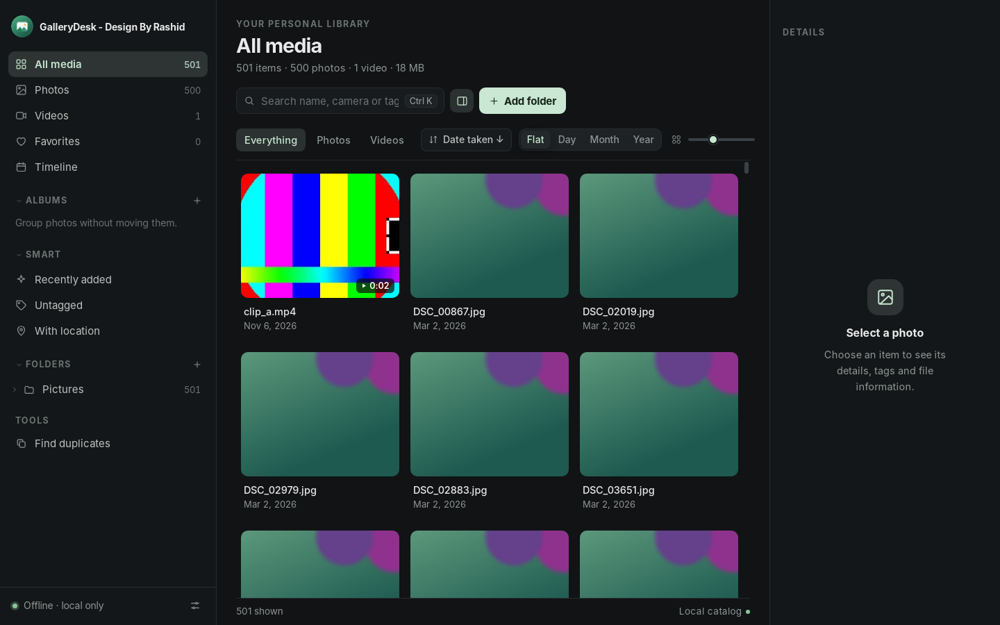
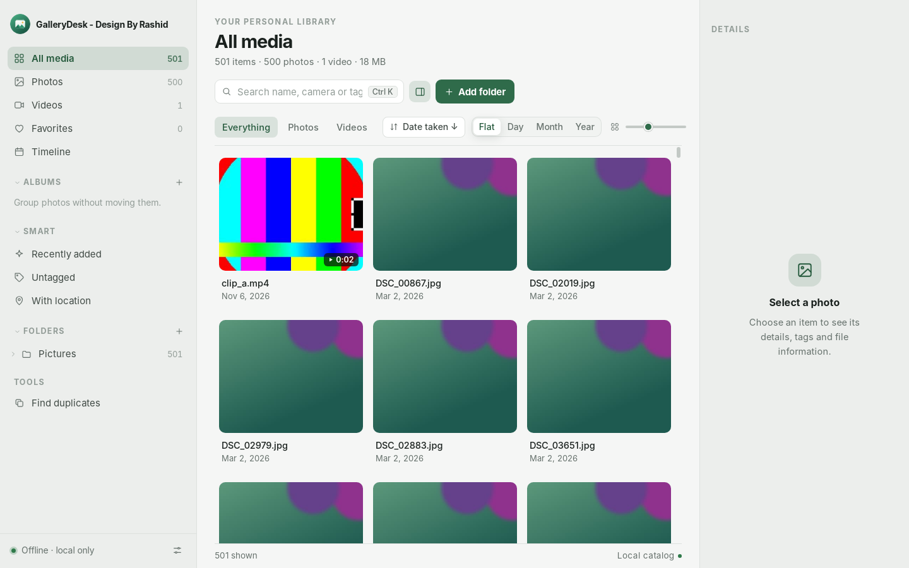
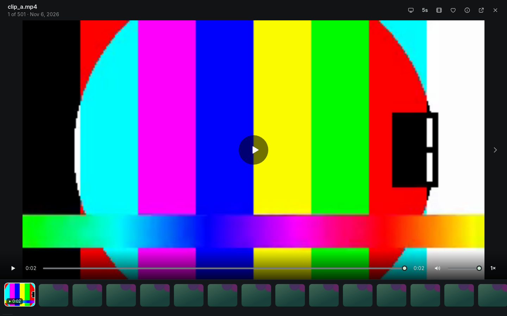
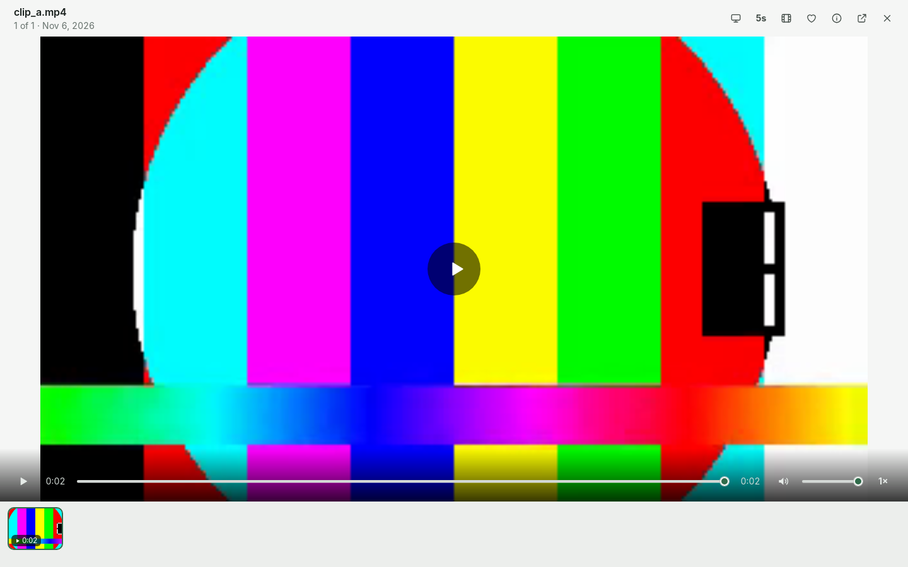

<div align="center">


# GalleryDesk - Design By Rashid

**An offline-first photo and video manager for Linux.**
It works directly on the folders you already have. Nothing is imported, moved, renamed or rewritten.
No account, no cloud, no telemetry.

`Version 1.0.0` · Linux x86_64 · Tauri 2 · Rust · TypeScript

</div>

<p align="center">
  
  
</p>
<p align="center">
  
  
</p>
<p align="center"><sub>Screenshots use generated sample media.</sub></p>

---

## Contents

1. [Why GalleryDesk](#why-gallerydesk)
2. [Features](#features)
3. [Install](#install)
4. [Using the app](#using-the-app)
5. [Keyboard shortcuts](#keyboard-shortcuts)
6. [Settings reference](#settings-reference)
7. [Your data and privacy](#your-data-and-privacy)
8. [Build from source](#build-from-source)
9. [Project layout](#project-layout)
10. [Architecture notes](#architecture-notes)
11. [Testing](#testing)
12. [Troubleshooting](#troubleshooting)
13. [Known limitations](#known-limitations)
14. [Roadmap](#roadmap)
15. [Contributing](#contributing)
16. [License](#license)

---

## Why GalleryDesk

Most photo managers want to *own* your photos: import them, copy them into their own library, or sync them to a server. GalleryDesk does the opposite.

- **Your files stay where they are.** Point it at folders; it builds a small catalog (SQLite) next to its thumbnails. Originals are opened read-only.
- **Everything is local.** The only network socket is a loopback-only, token-protected, read-only server that feeds the video player. There is no telemetry and no update check.
- **It stays fast on big libraries.** The grid is virtualised (tested with 4,000 items, designed for 100,000+), scanning runs off the UI thread, and previews are generated while a scan is still walking your folders.

## Features

### Library
- Add any number of folders; they persist between launches.
- Background indexing with progress and **Cancel**. Unchanged files are skipped on rescan, an unplugged drive never wipes its catalog entries, and moved files keep their favorites, tags and albums.
- **Exclude folders** (Settings → Library): an absolute path skips that folder and everything under it; a bare name such as `node_modules` skips every folder with that name. Excluded items are removed from the library, ignored by scans and the watcher, and come back on the next scan if you delete the rule.
- Optional **file watcher** picks up added and removed files automatically.
- Hidden folders and common dependency / trash folders (`node_modules`, `venv`, `site-packages`, `__pycache__`, `snap`, `target`, `Trash`) are skipped.

### Browse and organise
- All media / Photos / Videos / Favorites / **Timeline** (group by day, month or year), folder tree, sorting (date taken, name, date added, size, type), search by name, camera or tag, adjustable thumbnail size, fill or fit.
- Favorites, albums, tags, three smart collections (recently added, untagged, with location), multi-select (Ctrl / Shift click, Ctrl A), non-destructive rotate.
- Exact **duplicate finder** (content hash, read-only) and catalog backup / restore.

### Viewer
- **Double-click a photo** to open the in-app slideshow: zoom and pan, auto-advance (3 / 5 / 8 s), keyboard navigation, details panel, and a **film-strip carousel** along the bottom (click or scroll to jump; `T` toggles it).
- **Double-click a video** to play it in the built-in player: play / pause, seek, volume, speed, full screen. If the codec is not supported by the web engine, a playback copy is made in the cache (the original is never touched).
- The viewer follows the selected theme, light or dark.

### Metadata
- Images: EXIF date, camera, lens, exposure, focal length, GPS (shown as coordinates).
- Videos: duration, size, date.
- Capture dates are stored as "wall-clock time as if UTC", so a photo taken at 23:30 stays on that day in every time zone.

### Look and feel
- System / Light / Dark themes and five accent colours (Settings → Appearance).
- Larger, readable type; keyboard-first navigation.

## Install

### AppImage (recommended)

1. Download `GalleryDesk - Design By Rashid_1.0.0_amd64.AppImage` from the [Releases](../../releases) page.
   *(Large files may be published as numbered `.part` pieces: put them in one folder and run `./join.sh`, which reassembles and checksum-verifies the AppImage.)*
2. Make it executable and run it:
   ```bash
   chmod +x "GalleryDesk - Design By Rashid_1.0.0_amd64.AppImage"
   ./"GalleryDesk - Design By Rashid_1.0.0_amd64.AppImage"
   ```
3. Optional: set `APPIMAGE_EXTRACT_AND_RUN=1` if your system has no FUSE 2.

**Runtime requirements on the host**

| Needed | Why |
|---|---|
| `ffmpeg` and `ffprobe` on `PATH` | thumbnails and video metadata. Settings → About tells you if they are missing |
| A graphical Linux session (X11 or Wayland) | the UI is a WebKitGTK webview |

The AppImage bundles the GTK / WebKit stack **and a matching set of GStreamer plugins** (including H.264 via libav), so video playback does not depend on what your distribution ships. FFmpeg is deliberately *not* bundled; it is used from your system.

Install FFmpeg if you do not have it:

```bash
sudo apt install ffmpeg          # Debian / Ubuntu
sudo dnf install ffmpeg          # Fedora (RPM Fusion)
sudo pacman -S ffmpeg            # Arch
```

## Using the app

1. Click **Add folder** and choose a folder (for example `~/Pictures`). Indexing starts straight away; thumbnails appear while the scan is still running.
2. Browse with the sidebar, tabs and search. Click a tile to select it and see details; double-click (or press Enter / Space) to open the viewer.
3. Favorite with `F`, rotate with `R`, add tags and albums from the details panel.
4. Use **Settings** (`Ctrl ,`) to change theme, exclude folders, turn the watcher on or off, back up the catalog, and see system status.

Adding a very large folder (such as your whole home directory) works but takes longer. Adding only `~/Pictures` and `~/Videos` is much faster.

## Keyboard shortcuts

| Key | Action |
|---|---|
| `Ctrl K` | Search |
| `Ctrl 1` … `Ctrl 5` | All · Photos · Videos · Favorites · Timeline |
| Arrow keys | Move through the grid |
| `Enter` / `Space` | Open in viewer |
| `F` | Favorite |
| `R` / `Shift R` | Rotate right / left |
| `I` | Details panel |
| `Ctrl A` | Select all |
| `Esc` | Close · clear selection |
| `←` `→` (viewer) | Previous / next |
| `+` `−` `0` `1` (viewer) | Zoom in / out · fit · 100% |
| `T` (viewer) | Toggle film-strip |
| `Ctrl ,` | Settings |

## Settings reference

| Tab | What it controls |
|---|---|
| **Appearance** | Theme (system / light / dark), accent colour, tile size, fill or fit, captions |
| **Library** | Exclude folders, watch for changes, scan on launch, worker threads, built-in video player on / off |
| **Catalog** | Backup and restore of the catalog (the database only, never your media) |
| **Shortcuts** | The list above |
| **About** | Version, FFmpeg / ffprobe status, built-in player status, data location |

## Your data and privacy

- Originals are **never** modified, moved, renamed or deleted. They are only read.
- The catalog and caches live in `~/.local/share/io.gallerydesk.app/`:

  | Path | Content |
  |---|---|
  | `library.sqlite3` | the catalog: folders, items, metadata, favorites, tags, albums, settings |
  | `thumbnails/` | grid thumbnails |
  | `previews/` | larger viewer previews and video playback copies |

  Set `GALLERYDESK_DATA_DIR=/some/path` to put it elsewhere. Deleting the folder only loses your favorites, tags and albums; a rescan rebuilds the rest.
- **No telemetry, no accounts, no network calls to the internet.** The video player is fed by a server bound to `127.0.0.1` only, protected by a random per-run token, read-only, and limited to files inside your added folders.
- Old data from the pre-release "Luma Photo Manager" (`io.luma.photomanager`) is migrated automatically on first launch.

## Build from source

### Prerequisites

- Linux x86_64, **Node.js 20+**, **Rust stable**
- Tauri 2 system packages (Debian / Ubuntu names):
  ```bash
  sudo apt install build-essential curl wget file pkg-config patchelf \
       libwebkit2gtk-4.1-dev libgtk-3-dev libayatana-appindicator3-dev librsvg2-dev libssl-dev
  ```
- `ffmpeg` and `ffprobe` (needed at runtime and by the test suite)
- To produce an AppImage with video support, the GStreamer plugin packages are copied into the bundle, so install them on the build machine:
  ```bash
  sudo apt install gstreamer1.0-plugins-base gstreamer1.0-plugins-good \
       gstreamer1.0-plugins-bad gstreamer1.0-libav gstreamer1.0-gl
  ```

### Run in development

```bash
npm install
npm run tauri dev        # Vite dev server on http://127.0.0.1:1420 + the Rust app
```

### Type-check and build the frontend

```bash
npm run build
```

### Build the AppImage

```bash
npm run tauri build -- --bundles appimage
# or: ./scripts/build-appimage.sh
```

The result is in `src-tauri/target/release/bundle/appimage/` (about 157 MB, because it contains the GStreamer plugin set). Bundling downloads `linuxdeploy` and its plugins on first use.

### Versioning

The version lives in three places; keep them in sync when you release: `package.json`, `src-tauri/Cargo.toml` and `src-tauri/tauri.conf.json`. The app reads it from `Cargo.toml`.

## Project layout

```
.
├── index.html                  app shell
├── public/                     icon.svg, theme-boot.js (prevents a flash of the wrong theme)
├── src/                        TypeScript UI (no framework)
│   ├── main.ts                 wiring, settings, navigation, keyboard handling
│   ├── grid.ts                 virtualised grid
│   ├── viewer.ts               slideshow, film-strip, video player
│   ├── ui.ts                   menus, dialogs, toasts
│   ├── api.ts                  typed wrappers around Tauri commands
│   ├── icons.ts                inline SVG icon set
│   └── style.css               design tokens (light + dark) and components
├── src-tauri/
│   ├── tauri.conf.json         window, bundle, asset-protocol and AppImage settings
│   ├── icons/                  app icons (round)
│   ├── src/
│   │   ├── lib.rs              app state, events, Tauri commands
│   │   ├── db.rs               schema and migrations
│   │   ├── scan.rs             discovery, reconcile, worker pool, progress and cancel
│   │   ├── media.rs            EXIF, ffprobe, thumbnails, host-tool environment, GStreamer setup
│   │   ├── query.rs            filters, sorting, paging, albums, tags, duplicates, backup, settings
│   │   ├── exclude.rs          excluded-folder rules
│   │   ├── stream.rs           loopback, token-protected, Range-capable media server
│   │   └── watch.rs            optional folder watcher with debounce
│   └── tests/core.rs           integration tests
├── scripts/                    build-appimage.sh, make-test-fixtures.py
├── docs/screenshots/           images used in this README
├── UI-CONCEPT.html             design concept page
└── HANDOVER-STATUS.md          detailed status, fixed defects and decisions
```

## Architecture notes

- **Backend:** Rust. SQLite (`rusqlite`) with one connection per call. A scan runs in a background job: discovery walks the folders and commits rows in small batches, while a preview worker pool renders thumbnails **concurrently**, so previews appear within seconds even on large folders.
- **Thumbnails** are rendered with FFmpeg using `-noautorotate` and explicit EXIF orientation, so output does not depend on the FFmpeg version. The cache key includes path, size, mtime, rotation and thumbnail size, so edited files never show stale previews. Failed previews are retried after an upgrade, and missing thumbnail files are healed on the next scan.
- **Frontend:** plain TypeScript and Vite, no framework. Originals are read by the webview through Tauri's asset protocol, whose scope is granted **per folder at runtime**, so the webview can only read folders you added.
- **Video:** played by the webview's `<video>` element, fed over a loopback server with HTTP Range support. If the web engine cannot decode a file, FFmpeg makes a playback copy in the cache.
- **AppImage environment hygiene:** the AppImage launcher exports its own `LD_LIBRARY_PATH`, `PATH`, `GST_*` and similar variables. Programs started from the app (ffmpeg, ffprobe, xdg-open, dbus-send) get a copy of the environment with those entries removed (`media::host_command`), so they always load your system's libraries.
- **GStreamer:** the AppImage ships a complete matching plugin set and uses only that, with a private plugin registry; hardware (VA-API / NVDEC) decoders are ranked off so decoding is in software, and WebKit's DMABUF renderer is disabled. This avoids hangs caused by mixing bundled libraries with newer system plugins or GPU drivers.
- **Crash guard:** if the built-in video player ever fails to report ready (for example the process was force-quit mid-open), the next launch switches it off and shows a notice; it can be turned back on in Settings → Library.

See [`HANDOVER-STATUS.md`](HANDOVER-STATUS.md) for the full list of defects found and fixed during development.

## Testing

```bash
cd src-tauri
cargo test --release        # 22 integration tests (needs ffmpeg and ffprobe)
python3 ../scripts/make-test-fixtures.py   # regenerate test media (needs Pillow, piexif, ffmpeg)
cd .. && npm run build      # TypeScript type-check + production build
```

The suite covers scanning and rescans, moved and deleted files, exclusion rules, favorites / tags / albums, sorting and timeline ordering, EXIF edge cases, duplicate detection, catalog backup and restore, legacy catalog migration, host-tool environment cleaning, and the upgrade routine.

## Troubleshooting

| Symptom | What to check |
|---|---|
| No previews at all | Settings → About: is **FFmpeg** found? Install `ffmpeg` and restart. Large folders take a while; previews appear progressively. |
| A video opens in your default player instead | Settings → Library → **Play videos in the built-in player** must be ON. Settings → About shows the player status. |
| The window does not start from an AppImage | Try `APPIMAGE_EXTRACT_AND_RUN=1 ./GalleryDesk….AppImage` (no FUSE 2), and run it from a terminal to see messages. |
| Scan seems slow | Add specific folders instead of your whole home directory, and use **Exclude folders** for archives and caches. |
| Changes on disk are not noticed | The watcher can hit the inotify limit on huge trees. Use **Rescan**, or raise `fs.inotify.max_user_watches`. |
| Start fresh | Quit the app and delete `~/.local/share/io.gallerydesk.app/`. Your media is not affected. |

When reporting a bug, please include your distribution, desktop session type (X11 / Wayland), the output of `ffmpeg -version | head -1`, and the terminal output of the app.

## Known limitations

- Linux x86_64 only for now. AppImage is the supported package.
- RAW files: embedded-JPEG preview only (no RAW development).
- Duplicate detection is exact (content hash); there is no "similar image" matching yet.
- GPS is shown as coordinates; there is no map view.
- XMP / IPTC metadata is not read.
- Smart collections are built in; user-defined rules are not available yet.

## Roadmap

- Perceptual similarity and burst / RAW+JPEG stacks
- Map view for geotagged photos
- User-defined smart albums
- Contact sheets and export
- `.deb` / `.rpm` and Flatpak packaging

## Contributing

Issues and pull requests are welcome. Please keep the two core principles intact: **originals are never modified**, and **nothing leaves the machine**. Before opening a PR:

```bash
npm run build
cd src-tauri && cargo test --release && cargo clippy --release
```

## License

No license has been chosen yet. Add a `LICENSE` file before publishing (MIT or Apache-2.0 are common choices for a project like this) and update this section.

---

<sub>GalleryDesk - Design By Rashid · built with Tauri 2, Rust and TypeScript.</sub>
